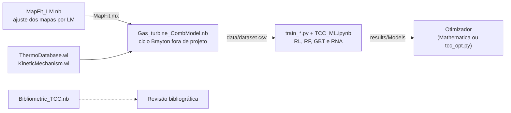

# Turbina a gás com gás de síntese de borra de petróleo e modelos substitutos de aprendizado de máquina

Códigos do Trabalho de Conclusão de Curso de **Hiago David Zogbi Silva Oliveira**, Engenharia Química/Mecânica, Universidade Federal Fluminense (UFF), Laboratório de Termociências (LATERMO), com orientação da Dra. Isabela Florindo.

O trabalho avalia o aproveitamento energético do gás de síntese obtido da gaseificação de borra de petróleo em uma turbina a gás operando fora do ponto de projeto. Um modelo termodinâmico do ciclo Brayton, com combustão em equilíbrio químico e mapas de compressor e turbina, gera um banco de dados que é usado para treinar modelos substitutos de aprendizado de máquina. Os modelos substitutos representam a eficiência térmica $\eta_{th}$, a geração de entropia $\dot S_{ger}$ e o índice de emissão de NOx $EI_{NO_x}$ em função das condições operacionais

$$
\mathbf{x}=[\dot m_f,\ \alpha,\ T_f,\ T_1],\qquad \widehat{y}_j=\widehat{F}_{ML,j}(\mathbf{x};\mathbf{h}_j^*),
$$

e são usados na otimização das condições de operação.

## Fluxo de trabalho



## Estrutura do repositório

```text
.
├── data/
│   └── dataset.csv                 banco gerado pelo modelo termodinâmico (8500 pontos)
├── mathematica/
│   ├── Gas_turbine_CombModel.nb    ciclo Brayton, combustão em equilíbrio, análise paramétrica,
│   │                               geração do banco, baseline de ML e otimizador
│   ├── MapFit_LM.nb                ajuste dos mapas de compressor e turbina por Levenberg–Marquardt
│   ├── ThermoDatabase.wl           propriedades NASA-7 (cp, h, s, g) a partir do THERM.DAT
│   ├── KineticMechanism.wl         leitura do mecanismo DRM19 + subconjuntos NOx/SOx
│   └── Bibliometric_TCC.nb         análise bibliométrica (exportações RIS do Scopus)
├── python/

│   ├── train_LR.py                 regressão linear (referência)
│   ├── train_RF.py                 floresta aleatória
│   ├── train_GBT.py                gradient boosting
│   ├── train_NN.py                 rede neural (1 ou 2 camadas ocultas)
│   └── TCC_ML.ipynb                EDA, comparação, seleção, avaliação, tamanho do banco e exportação
├── results/                        saídas geradas pelos códigos (ver results/README.md)
├── requirements.txt
└── LICENSE
```

## Instalação

Python 3.10 ou superior e, para os notebooks `.nb`, Wolfram Mathematica 14 ou superior.

```bash
git clone https://github.com/<usuario>/<repositorio>.git
cd <repositorio>
python -m venv .venv
source .venv/bin/activate          # Windows: .venv\Scripts\activate
pip install -r requirements.txt
```

## Como reproduzir

Os comandos em Python são executados a partir da pasta `python/`.

**1. Mapas e banco de dados (Mathematica).** Rode `MapFit_LM.nb`, que grava `MapFit.mx`, e depois `Gas_turbine_CombModel.nb` até a seção *Geração do banco de dados*, que grava `data/dataset.csv`. Os notebooks usam caminhos relativos à própria pasta (`SetDirectory[NotebookDirectory[]]`). Os arquivos de entrada que não fazem parte do repositório estão listados abaixo. O `dataset.csv` usado no TCC já está em `data/`, de modo que esta etapa só é necessária para regenerá-lo.

**2. Análise exploratória e comparação dos algoritmos.** Seções 1 e 2 de `TCC_ML.ipynb`.

**3. Busca de hiperparâmetros.** Cada código tem duas etapas. A seleção avalia as configurações por validação cruzada de cinco partições no treino, e o treino final ajusta as configurações escolhidas e as avalia em validação e teste.

```bash
python train_LR.py
python train_RF.py  --cv && python train_RF.py  --train --sel 5
python train_GBT.py --cv && python train_GBT.py --train --sel best
python train_NN.py  --cv && python train_NN.py  --train --sel best
```

A opção `--sel` aceita `best`, um inteiro $k$ (as $k$ melhores), `all` ou uma configuração em JSON, por exemplo `--sel '{"c1": 46, "lr": 0.003, "batch": 32}'`. O espaço de busca, o número de processos e as demais opções ficam no bloco de configuração no início de cada código. Uma execução interrompida continua de onde parou.

**4. Seleção, avaliação e exportação.** Seções 3 a 6 de `TCC_ML.ipynb`. O modelo de menor $\overline{MSE}_{CV}$ de cada resposta é exportado para `results/Surrogate/`.

**5. Otimização.** Seção *Otimizador* de `Gas_turbine_CombModel.nb`, que lê os pesos do `.keras` e o min-max do `_scalers.csv` de cada RNA em `results/Models/`. O módulo `tcc_opt.py` faz a mesma otimização em Python (evolução diferencial com refinamento por Levenberg–Marquardt).

## Divisão dos dados

A divisão em treino, validação e teste é a mesma em todos os códigos e no notebook. O teste recebe 15 % do total e a validação $3/17$ do restante, o que resulta em 70/15/15 %, com `random_state = 10`. Como os índices dependem apenas do número de linhas e da semente, a divisão é reproduzida a cada execução e nenhum arquivo de divisão é exportado. A normalização min-max de $\mathbf{x}$ e de $y$ é ajustada apenas no treino e, na validação cruzada, apenas nas partições de ajuste de cada rodada.

## Arquivos externos não incluídos

| Arquivo | Pasta | Uso |
|---|---|---|
| `THERM.DAT` | `mathematica/` | coeficientes NASA-7 (ThermoDatabase.wl) |
| `drm19.dat` | `mathematica/` | mecanismo DRM19, GRI-Mech 1.2 reduzido (KineticMechanism.wl) |
| `MapasGasTurb.xlsx` | `mathematica/` | pontos digitalizados dos mapas do GasTurb (MapFit_LM.nb) |
| `Q1*.ris` … `Q5*.ris` | `mathematica/` | exportações do Scopus (Bibliometric_TCC.nb) |
| `Mapa compressor.jpg` | `mathematica/` | imagem para a digitalização manual de curvas (seção MAPA) |

`MapFit.mx` é gerado por `MapFit_LM.nb` e não é versionado, pois o formato `.mx` depende da plataforma.

## Como citar

OLIVEIRA, H. D. Z. S. *Aproveitamento energético de gás de síntese de borra de petróleo em turbina a gás com modelos de aprendizado de máquina*. Trabalho de Conclusão de Curso, Universidade Federal Fluminense, Niterói, 2026.

## Licença

Distribuído sob a licença MIT. Ver `LICENSE`.
